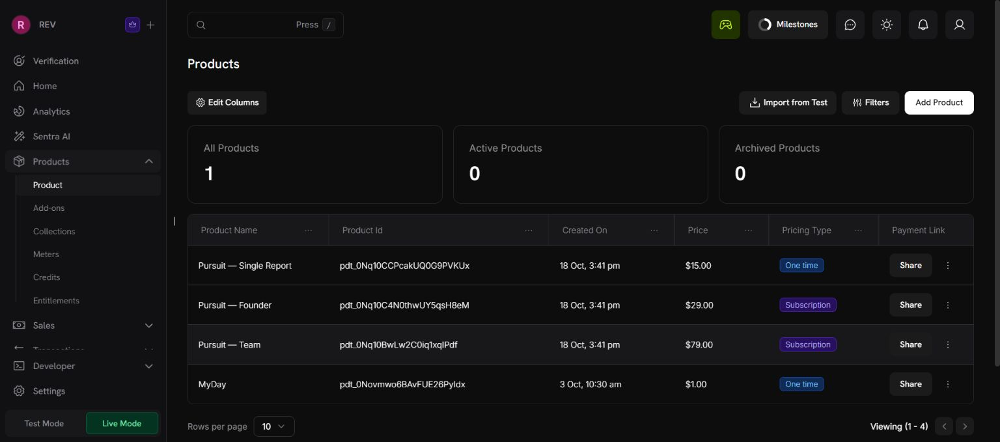
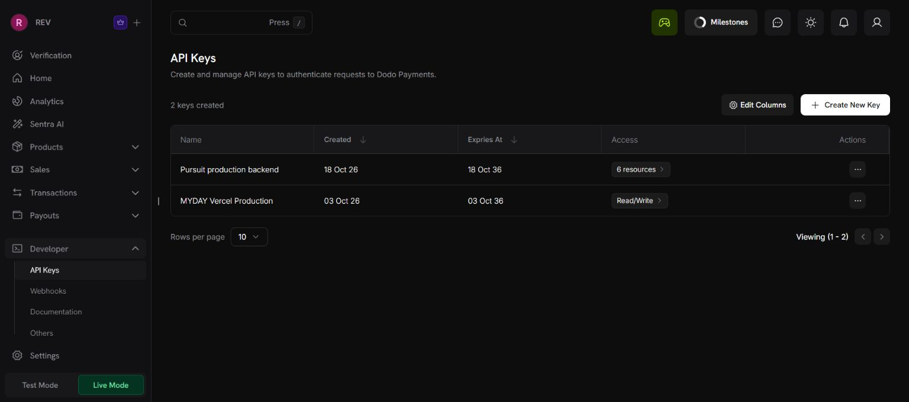
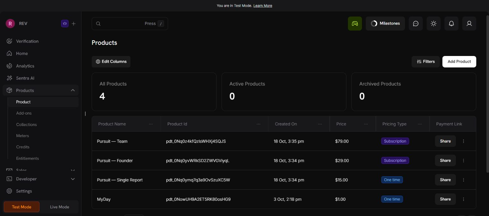

# Merchant account setup status

## Launch price revision — verified live 2026-10-19

New purchase targets: Single Report USD 4.99 once, Founder USD 11.99/month,
Team USD 34.99/month. Allowances, seats, product IDs, currency and billing intervals
are unchanged. All three live product edits were saved in Dodo and passed the
read-only catalogue verifier. The Vercel website returns the revised prices.
Unconfirmed hosted checkout pages showed each USD base price before tax; no
payment was submitted. The older records below retain their historical prices.
Existing subscriptions are not migrated or repriced by this change.

## Live catalog — original setup

The user requested live mode after the test setup. Dodo's Verification page states **Live payments are active** and Product Information, Personal Information and Bank Verification are approved. No identity/bank details were changed.

| Live Pursuit product | Provider ID | Price |
| --- | --- | --- |
| Single Report | `pdt_0Nq10CCPcakUQ0G9PVKUx` | USD 15 once |
| Founder | `pdt_0Nq10C4N0thwUY5qsH8eM` | USD 29 every month |
| Team | `pdt_0Nq10BwLw2C0iq1xqIPdf` | USD 79 every month |

Imported these three products using Dodo's Import from Test tool. Live catalog visibly lists all three at their agreed prices. Existing MyDay live product preserved. Local ignored backend configuration now selects `live_mode` and these live IDs. Checkout remains unavailable until the API/webhook credentials are configured.

A separate `Pursuit production backend` live key was created after user confirmation with Payments/Refunds/Subscriptions/Products Read and Customers/Checkout Sessions Write; all other resources None. The first unused key appeared in setup inspection output and was permanently revoked with explicit user approval. Its replacement was saved directly to ignored `backend/.env` without returning its value. The pre-existing MyDay live key was left unchanged.

Executed `PYTHONPATH=. python scripts/verify_billing_catalog.py` from `backend`: all three real live products passed server-side merchant, product, currency, price and subscription checks (USD 15 / 29 / 79). This script performs read-only API requests; it creates no checkout, payment, customer or subscription. Webhook signing key configured: False.

Still required: deployed HTTPS webhook URL/signing secret, customer portal verification, and authorized end-to-end payment verification. Checkout remains disabled while webhook configuration is missing. No payment was made. Merchant approval alone does not establish Pursuit deployment or payment-flow readiness.

## Earlier test catalog (preserved)

Verified in the signed-in Dodo Payments dashboard on 2026-10-18, in **Test Mode**.

| Pursuit product | Provider ID | Price |
| --- | --- | --- |
| Single Report | `pdt_0Nq0ymq7q3a9OvSzuXC5W` | USD 15 once |
| Founder | `pdt_0Nq0yvWRkSD2ZWVGViyqL` | USD 29 every month |
| Team | `pdt_0Nq0z4kfQzlsWHXj4SQJS` | USD 79 every month |

Created with SaaS tax classification, fixed USD prices, no trial, no discounts, no PPP, and no localized prices. Existing unrelated MyDay product was preserved. Catalog IDs and business ID were saved to the ignored local backend configuration. No credentials are included in this document or Git.

## Pending

- API key: no existing test keys. Prepared `Pursuit local test backend` with Payments/Refunds/Subscriptions/Products **Read**, Customers/Checkout Sessions **Write**, and all other permissions **None**. Persistent credential creation requires action-time confirmation; it has not been created.
- Webhook: dashboard has no endpoints. Requires publicly reachable HTTPS URL ending in `/api/billing/webhook`; localhost is not reachable by Dodo. No endpoint or signing secret created yet.
- Customer portal: not yet verified using a configured API key and real test customer.
- Hosted checkout, provider signature delivery, credits, cancellation and renewal: not yet verified against the merchant account. Local fixture tests are documented separately in `BILLING_VERIFICATION.md`.
- Live-mode product setup is recorded above; no new key or real/simulated checkout payment was executed during account configuration.
